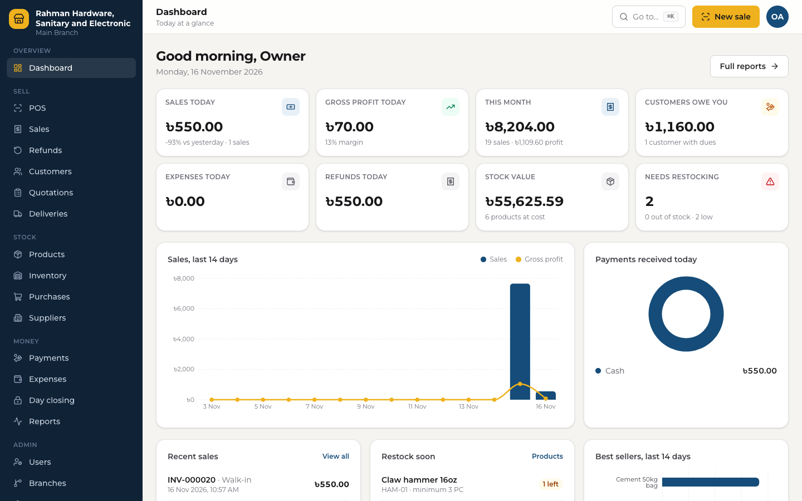
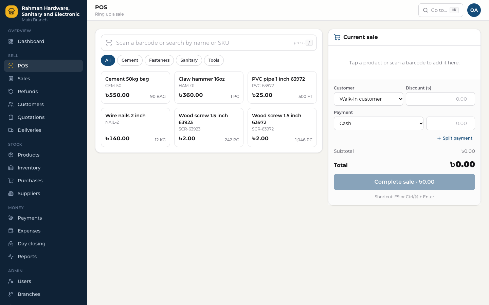
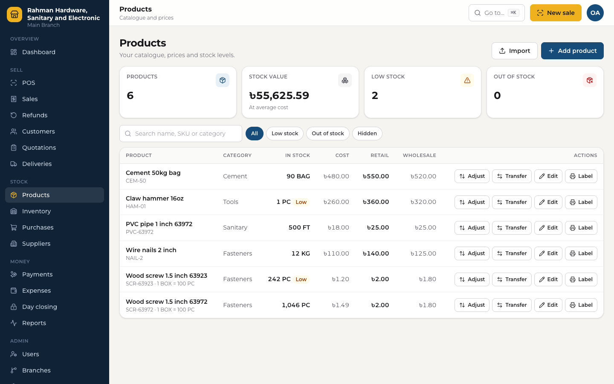
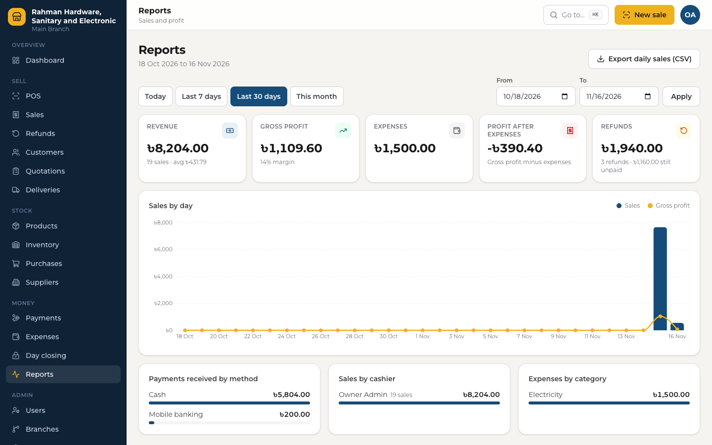
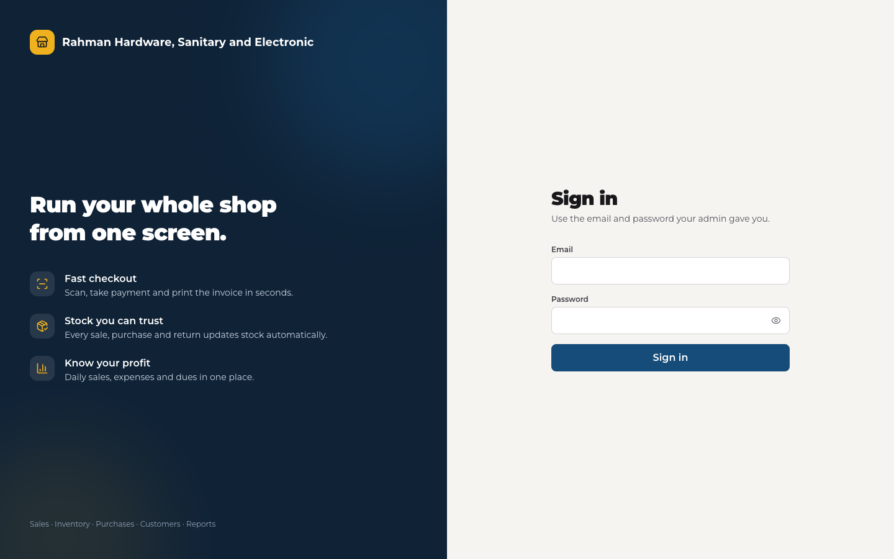
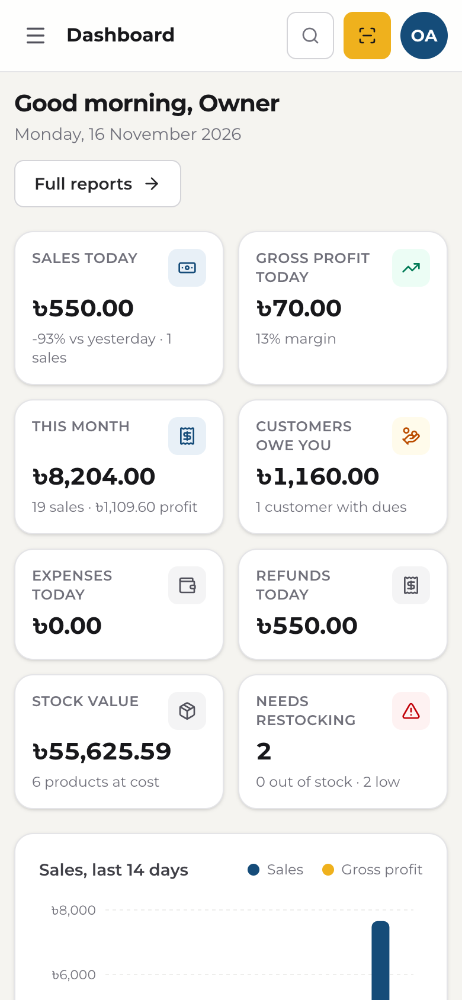
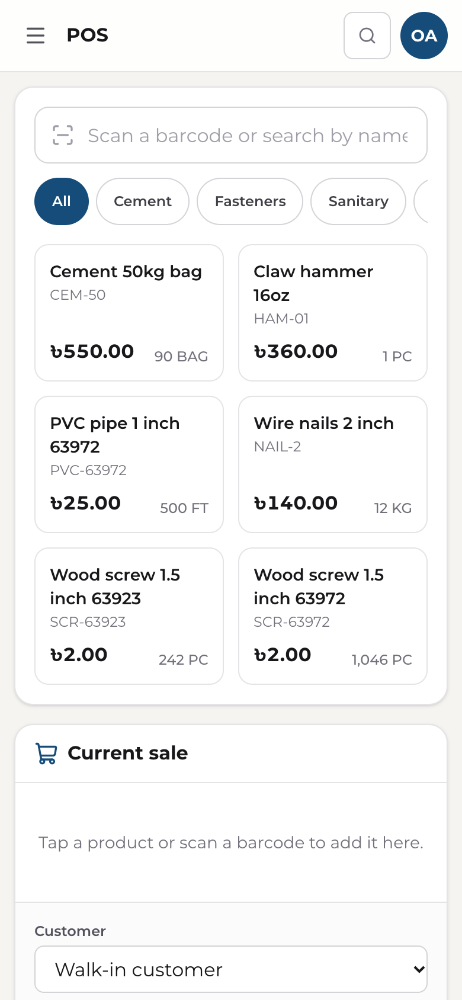
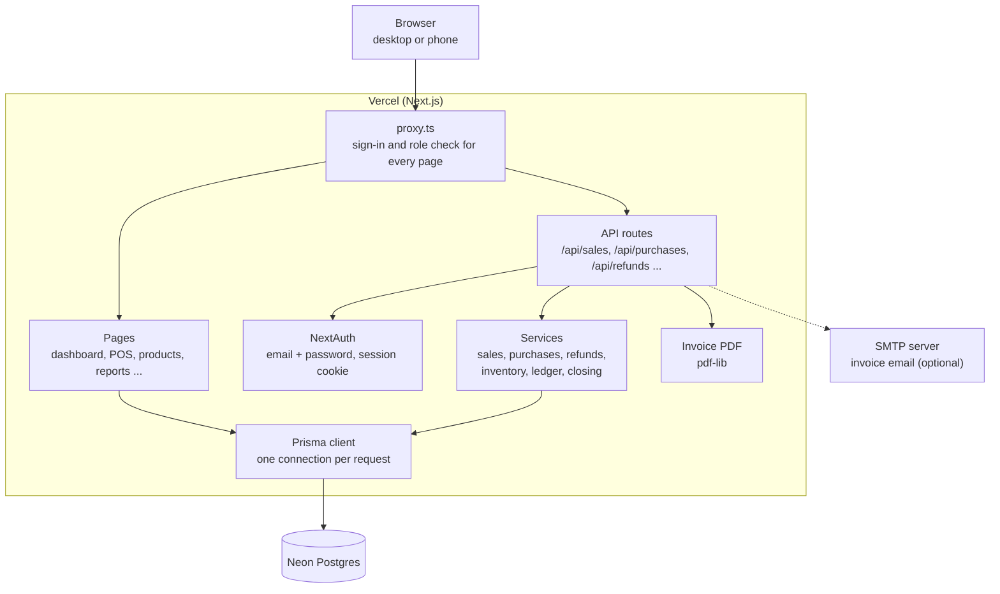
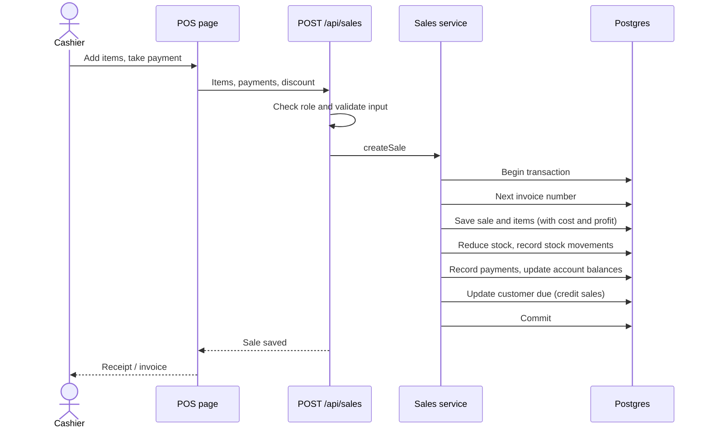
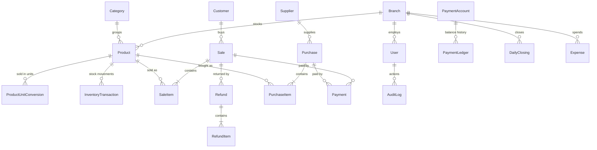

# Rahman Hardware, Sanitary and Electronic — Shop POS

A point-of-sale and shop management app for a hardware, sanitary and electronics
shop. It covers the counter (sales, refunds, quotations, deliveries), the store
room (products, stock, purchases, suppliers) and the books (payments, expenses,
day closing, reports) in one place, on desktop and on a phone.



## Contents

- [Features](#features)
- [Screenshots](#screenshots)
- [Architecture](#architecture)
- [Tech stack](#tech-stack)
- [Project structure](#project-structure)
- [Run it on your computer](#run-it-on-your-computer)
- [Deploy to Vercel](#deploy-to-vercel)
- [Staff roles](#staff-roles)

## Features

**Sell**

- **POS** — scan a barcode or search by name, pick a customer, apply a discount,
  split a payment across cash, card, bank, bKash/Nagad or cheque, and sell on credit.
- **Invoices and receipts** — A4 invoice PDF, a thermal-style receipt page, and
  invoice email.
- **Refunds** — return some or all items of a sale; stock and cash are corrected automatically.
- **Customers** — dues, payment collection, account statements and WhatsApp reminders.
- **Quotations and deliveries** — price quotes that can be tracked, and delivery tracking.

**Stock**

- **Products** — retail, wholesale and minimum prices, multiple units
  (for example 1 BOX = 100 PC), barcode labels and CSV import.
- **Inventory** — every sale, purchase, return and adjustment is recorded as a
  stock movement, with low-stock and out-of-stock alerts.
- **Purchases and suppliers** — purchase orders, partial receiving, supplier dues
  and payments, and a reorder list. Product cost is tracked as a weighted average.
- **Branches** — more than one branch, with stock transfer between them.

**Money**

- **Payment accounts and ledger** — a running balance for each cash, bank and mobile account.
- **Expenses** — by category.
- **Day closing** — compares the cash that should be in the drawer with what was counted.
- **Reports** — revenue, gross profit, expenses and refunds by date range, with CSV export.

**Admin**

- **Staff roles** — five roles, each limited to its own pages and actions.
- **Audit log** — who changed what, and when.
- **Backup** — download all shop data as one file.
- **English and Bangla** interface.

## Screenshots

| Point of sale | Products |
| --- | --- |
|  |  |

| Reports | Sign in |
| --- | --- |
|  |  |

**On a phone**

<p>
  
  &nbsp;&nbsp;
  
</p>

## Architecture

The app is a single Next.js project. Pages render on the server and read the
database directly; anything that changes data goes through an API route, which
checks the staff member's role and then calls a service that does the work
inside one database transaction.



### What happens when a sale is completed



Because all of these steps share one transaction, a sale is either saved
completely or not at all; stock and cash can never disagree with the invoice.

### Data model (main tables)



The full schema, including quotations, deliveries, cheques and settings, is in
[`prisma/schema.prisma`](prisma/schema.prisma).

## Tech stack

| Part | Technology |
| --- | --- |
| Framework | Next.js 16 (App Router), React 19, TypeScript |
| Styling | Tailwind CSS 4, Montserrat, Lucide icons |
| Charts | Recharts |
| Database | Neon Postgres through Prisma 6 |
| Sign-in | NextAuth (email and password, bcrypt) |
| Validation | Zod |
| Invoice PDF | pdf-lib |
| Barcodes | bwip-js |
| Hosting | Vercel |

## Project structure

```
prisma/
  schema.prisma        database tables
  migrations/          database changes, applied in order
  seed.ts              first admin, units and payment accounts
src/
  proxy.ts             sends signed-out visitors to /login, enforces page access by role
  app/
    (auth)/login       sign-in page
    (dashboard)/       every signed-in page: dashboard, pos, products, sales, reports ...
    receipt/           printable receipt
    api/               API routes, one folder per area
  server/services/     business rules: sales, purchases, refunds, inventory, ledger, closing
  lib/                 database client, sign-in, roles, validation, formatting, invoice PDF
  components/          layout (sidebar, top bar, quick search) and shared UI parts
next.config.ts         Next.js configuration
```

## Run it on your computer

You need Node.js 20 or newer and a Postgres database (a free
[Neon](https://neon.tech) database works).

1. Install the packages:

   ```bash
   npm install
   ```

2. Copy `.env.example` to `.env` and fill it in:

   | Variable | What it is |
   | --- | --- |
   | `DATABASE_URL` | Neon pooled connection string |
   | `NEXTAUTH_URL` | `http://localhost:3000` |
   | `NEXTAUTH_SECRET` | a long random string (`openssl rand -base64 32`) |
   | `BOOTSTRAP_SETUP_KEY` | another long random string |
   | `SMTP_*` | optional, only for emailing invoices |

3. Create the database tables:

   ```bash
   npm run db:deploy
   ```

4. Create the first admin, with an email and password of your choice:

   ```bash
   SEED_ADMIN_EMAIL="you@example.com" SEED_ADMIN_PASSWORD="a-strong-password" npm run db:seed
   ```

5. Start the app and open http://localhost:3000:

   ```bash
   npm run dev
   ```

Useful commands:

| Command | What it does |
| --- | --- |
| `npm run dev` | start the app for development |
| `npm run build` | build the app for Vercel or a normal Node.js server |
| `npm run lint` | check the code |
| `npm run db:migrate` | create a new database migration |

## Deploy to Vercel

1. Import this repository in Vercel and keep the framework preset as **Next.js**.
2. Under **Settings → Environment Variables**, add these for **Production**:
   - `DATABASE_URL`
   - `DATABASE_URL_UNPOOLED`
   - `NEXTAUTH_URL`
   - `NEXTAUTH_SECRET`
   - `BOOTSTRAP_SETUP_KEY`
   - `SMTP_HOST`, `SMTP_PORT`, `SMTP_USER`, `SMTP_PASSWORD`, and `SMTP_FROM` if invoice email is needed.
3. Use the pooled Neon URL for `DATABASE_URL` and the direct Neon URL for
   `DATABASE_URL_UNPOOLED`. Redeploy after saving the variables.

Good to know:

- Secrets are not stored in the repository, so add them in Vercel by hand.
- Set `NEXTAUTH_URL` to the public Vercel URL, for example
  `https://shop-pos-five.vercel.app`.
- Use a direct database URL for Prisma migrations and the pooled URL for
  application traffic.
- The app also runs on any host that supports Next.js (`npm run build`, `npm start`).

### Production operations checklist

- Rotate the Neon database password before the first production deployment.
- Use separate Neon branches and Vercel variables for Preview and Production.
- Configure an uptime monitor against `/api/health`; it returns `503` when the database is unavailable.
- Configure error tracking (for example Sentry) through the provider dashboard without committing credentials.
- Enable Neon backups and define a restore test schedule.
- Protect `main` with required CI checks. The repository workflow runs lint, TypeScript, Prisma validation, and the production build.
- Review `npm audit` regularly and upgrade dependencies deliberately, testing authentication and invoice email after upgrades.

## Staff roles

| Role | Can do |
| --- | --- |
| Admin | Everything, including users, branches, settings, backup and the audit log |
| Manager | Sales, purchases, stock, customers, suppliers, expenses, payments, closing and reports |
| Cashier | POS, sales, refunds, customers, quotations, deliveries and day closing |
| Inventory | Products, stock and receiving purchases |
| Accountant | Read-only view of sales, purchases, payments, expenses and reports |

The health check is at `/api/health`.
